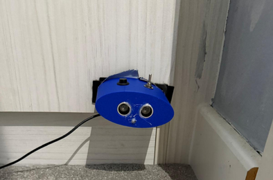

# Motion Sensor

A compact, portable device that detects approaching movement within a defined range. An ultrasonic sensor watches a distance that you set by calibration, and when something comes closer than that distance, the device raises an alert with an LED and, optionally, a siren. It was inspired by wanting to monitor nearby activity during interactive games. It runs on an Arduino Nano, powered over USB from a battery pack.

**Demo video:** [Watch the demo](docs/motionDemo.mp4)



---

## How it works

The device moves through four states:

| State | Meaning | How you get there |
|---|---|---|
| Uncalibrated | No reference distance yet | Power on |
| Calibrated | Reference distance stored, not watching | Short tap on the button |
| Armed | Watching for movement | Double tap on the button |
| Alarm | Something came closer than the reference | Detected automatically |

1. **Calibrate.** A short tap averages 10 ultrasonic readings and stores the result as the reference distance. The reading is only accepted if it is between 5 cm and 400 cm.
2. **Arm.** Two quick taps (within 400 ms of each other) arm the device. The LED turns off while it watches.
3. **Detect.** The sensor measures continuously. If a reading is more than 2.5 cm shorter than the reference distance, the alarm triggers.
4. **Stop.** Holding the button for 2 seconds while the alarm is going stops it and returns the device to the calibrated state.

## Alert modes

A 3-position toggle switch selects the mode. It is read continuously, so it can be changed at any time.

| Mode | Switch position | What happens |
|---|---|---|
| Full alarm | Left (pin 5 low) | LED and speaker. The speaker plays a siren that sweeps between 1500 Hz and 3000 Hz. |
| Silent alarm | Centre (default) | LED only, no sound. |
| Bluetooth | Right (pin 6 low) | No local alarm. The distance is streamed over Bluetooth and the state changes are sent as messages. |

### LED patterns

| State | Silent mode | Full alarm mode |
|---|---|---|
| Uncalibrated | Slow blink | Slow blink |
| Calibrated | Short flash every 0.5 s | Short flash every 0.6 s |
| Armed | Off | Off |
| Alarm | Fast blink | Fast blink and siren |

In Bluetooth mode the LED flashes briefly once per second.

## Controls

| Input | Action |
|---|---|
| Short tap (under 0.4 s) | Take a new reference distance and move to the calibrated state |
| Two quick taps | Calibrate and arm |
| Hold for 2 s during an alarm | Stop the alarm |
| Toggle switch | Select the alert mode |

A short tap always takes a new reference reading, so tapping while the device is armed recalibrates it and takes it out of the armed state.

### Bluetooth messages

The Bluetooth module sends these text messages at 9600 baud:

| Message | Meaning |
|---|---|
| `CAL` | Calibration succeeded |
| `ARM` | Device armed |
| `DISARM` | Device disarmed |
| `ALARM` | Movement detected |
| `STOP` | Alarm stopped by holding the button |
| A number | Current distance in cm (Bluetooth mode only) |

The same status messages are also printed to the Serial Monitor at 9600 baud.

## Hardware

- Arduino Nano
- HC-SR04 ultrasonic sensor
- LED
- Speaker
- Momentary push button
- 3-position toggle switch
- Bluetooth module [add model, or delete this line and the Bluetooth mode if your build has none]
- 3D-printed enclosure (blue PLA) from my own CAD design, with a removable, screw-secured cover

The wiring schematic is in `docs/schematic.png`.

### Pin map

| Component | Pin |
|---|---|
| Ultrasonic TRIG | 9 |
| Ultrasonic ECHO | 10 |
| LED | 13 |
| Speaker | 8 |
| Push button | 4 |
| Toggle switch, left position | 5 |
| Toggle switch, right position | 6 |
| Bluetooth RX / TX (SoftwareSerial) | 2 / 3 |

The button and the toggle switch inputs use the internal pull-up resistors, so they are active when pulled to ground.

## Setup

1. Open `motion_sensor.ino` in the Arduino IDE.
2. The code uses the built-in `SoftwareSerial` library.
3. Wire the hardware following the pin map above.
4. Upload, and power the device over USB.
5. Point the sensor at the area to watch, tap once to calibrate, then tap twice to arm.

## Design notes

- **Sensor mounting.** The position and fit of the ultrasonic sensor had to be consistent for reliable readings, so the enclosure has dedicated mounting features for it.
- **Fastening.** The LED and ultrasonic sensor are held with adhesive, the switch and button use bolted connections, and the speaker is mounted inside and soldered into the circuit before the final assembly.
- **Wiring.** Fitting this many 5 V and ground connections into a compact space was the main electrical challenge, so I made a soldered power and ground distribution rail along the board to give a reliable common connection and keep the wiring tidy.

## Limitations

- The alarm triggers on a single reading. There is no filtering or confirmation over several readings, so a stray low reading could cause a false alarm.
- It only detects objects that come at least 2.5 cm closer than the reference distance.
- Calibration is only accepted between 5 cm and 400 cm.
- The ultrasonic sensor has a limited beam angle.

## Possible improvements

- Require several consecutive low readings before triggering, to avoid false alarms.
- Add a separate gesture for disarming, so that a tap doesn't recalibrate.
- Limit how often the distance is sent in Bluetooth mode.

## Repository contents

```
motion_sensor.ino   Arduino firmware
docs/               Photos, schematic
```

## Credits

All code, mechanical design and testing are my own work.

Part of my MIT Maker Portfolio. Built by Rodryk Carvalho.
